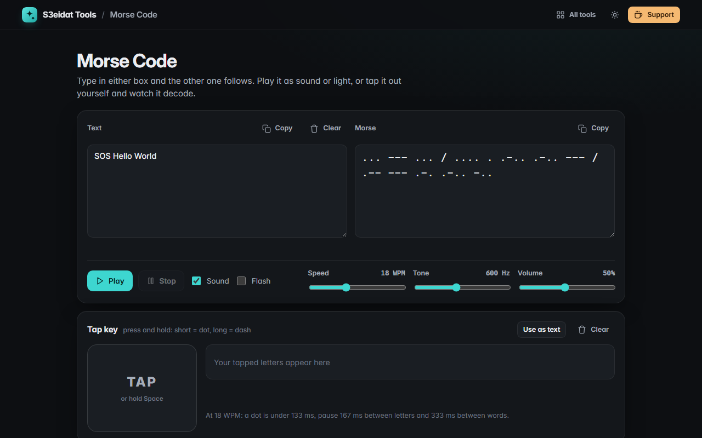

# Morse Code

> Translate Morse code and hear it. Free, private, and it runs entirely in your browser.

### ▶ [Open Morse Code](https://s3eidat.github.io/morse-code/)



## Features

- **Text ⇄ Morse live**: type in either box and the other follows (letters split by spaces, words by `/`)
- Understands look-alike symbols when decoding (`•`, `·`, `–`, `—`), and folds accents when encoding (é → E)
- 54 characters: A–Z, 0–9 and the ITU punctuation set
- **Play as sound** with the Web Audio API: speed 5–40 WPM, tone 300–1000 Hz, volume, click-free envelopes and
  standard timing (dash = 3 dots, letter gap = 3, word gap = 7)
- **Flash mode**: a light panel blinks the message. It plays at 6 WPM or slower (at most 2.5 flashes a second) to be
  gentle on people who are sensitive to flashing light.
- **Tap key**: hold the pad (or Space) for dots and dashes and watch your Morse decode live, with a sidetone; send it to the translator
- **Reference chart**: click any character to hear it

## Privacy

Nothing you type leaves your device. There is no server, no account, no analytics.
The page ships with a strict Content-Security-Policy (`connect-src 'self'`), so the browser
itself blocks any attempt to send data anywhere.

## Run it yourself

It's plain HTML, CSS and JavaScript with no build step:

```bash
git clone https://github.com/s3eidat/morse-code
cd morse-code
python -m http.server 8000
```

Then open http://localhost:8000.

## Support

If this saved you time, **[buy me a coffee ☕](https://s3eidat.github.io/coffee/)**. It keeps every tool free.

---

Part of **[S3eidat Tools](https://s3eidat.github.io/)**: 100+ free, private tools that run in your browser. MIT licensed.
